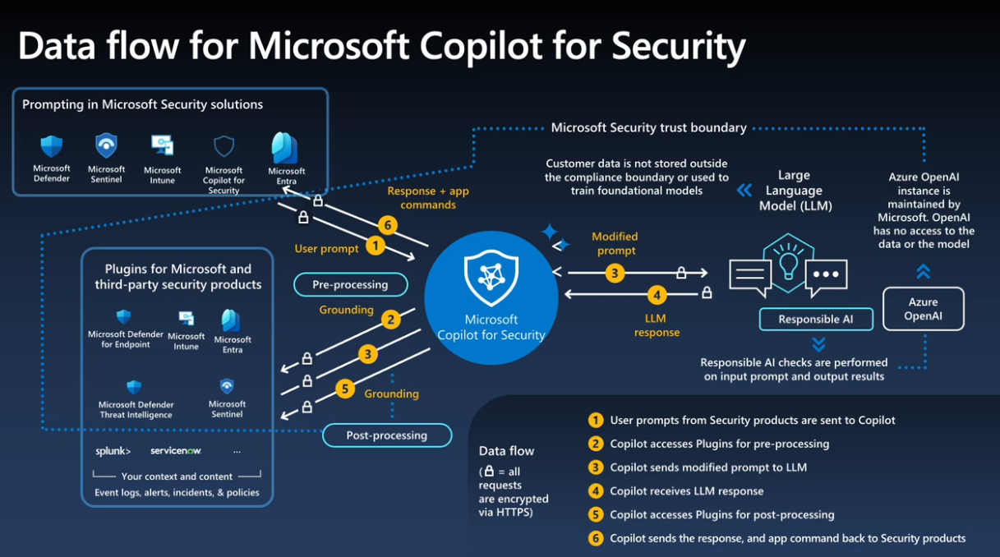

# Exam Practice Cloud and AI Security Engineer Associate (SC-500)

[Eaxm Practice: Cloud and AI Security Engineer Associate (SC-500)](https://app.pluralsight.com/assessment-pe/cloud-and-ai-security-engineer-associate-sc-500/intro)  

Each attempt is randomly generated. Retake the exam to gain confidence.
You have 14 days to complete each attempt before it expires.

---

# Q01

Contoso is onboarding an external contractor, `judy@vendor.com`, for a 30-day security review. 
Judy has a `B2B collaboration guest account` in Contoso and will receive `Security Copilot Contributor` access. 
`Vendor.com` manages Judy's device and can issue a `Microsoft Entra compliant-device claim`, but Contoso does not 
currently trust device-compliance claims from `vendor.com`.

Contoso requires Judy to satisfy multifactor authentication and use a compliant device when accessing Security Copilot. 
The requirement must be enforced by Contoso rather than relying solely on vendor.com's Conditional Access policies. 

Which configuration meets the requirement?

Select one answer option below.

## OPTION 01
In Contoso, require MFA and a compliant device with Conditional Access for Security Copilot, 
and configure inbound cross-tenant trust for vendor.com's compliant-device claim.

## OPTION 02
Rely on Judy's home tenant to enforce MFA and device compliance, since cross-tenant access 
settings automatically apply the resource tenant's requirements to guests

## OPTION 03
Assign Judy the `Copilot Owner role` instead of `Contributor`, since Owner-level access 
automatically enforces stronger sign-in requirements for guest accounts

## OPTION 04
Configure a `Microsoft Entra ID Protection user risk policy` requiring MFA whenever Judy's 
calculated sign-in risk level is high or medium

---

> Refs

[Microsoft Entra External ID B2C & External Identities- Deployment Architectures Formula5 ](https://www.youtube.com/watch?v=AJS1qGkAvmg&t=434s)  

---

# Gemini Argon 4

Correct Answer

## OPTION 01: 
In Contoso, require MFA and a compliant device with Conditional Access for Security Copilot, and 
configure inbound cross-tenant trust for vendor.com's compliant-device claim.

## Why OPTION 01 is Correct

- Resource-Tenant Enforcement: 
Contoso, the resource tenant, must create a Conditional Access policy targeting Microsoft Security Copilot 
and external/guest users ( judy@vendor.com ) with Grant controls set to Require multifactor authentication 
and Require device to be marked as compliant.

- Cross-Tenant Device Claim Trust: 
External B2B guest devices can only be managed/Intune-enrolled in their home tenant ( vendor.com ), 
not in the resource tenant ( Contoso ). Without configuring `Inbound Cross-Tenant Access Trust Settings` 
to trust  vendor.com 's compliant-device claims, Contoso's Conditional Access policy requiring a compliant 
device will always block Judy's sign-in.

- MFA Enforcement: 
Even if Contoso does not trust  vendor.com 's MFA claim, a B2B collaboration guest can satisfy MFA directly 
in Contoso (or in  vendor.com  if MFA trust is also enabled).

────────────────────

Why the Other Options Should Not Be Selected

> OPTION 02: Rely on Judy's home tenant to enforce MFA and device compliance, since cross-tenant access settings automatically apply the resource tenant's requirements to guests

- Why it's wrong: Cross-tenant access settings do not automatically push or enforce a resource tenant's security requirements onto a home tenant, nor do they create Conditional Access policies. You must explicitly configure a Conditional Access policy in Contoso to enforce access controls, and explicitly enable inbound trust settings (trusting MFA/device claims is disabled by default). Furthermore, the prompt explicitly states Contoso cannot rely solely on  vendor.com 's policies.

> OPTION 03: Assign Judy the  Copilot Owner role instead of  Contributor, since Owner-level access automatically enforces stronger sign-in requirements for guest accounts

- Why it's wrong: Security Copilot roles ( `Security Copilot Owner`  and  `Security Copilot Contributor` ) are `platform-level RBAC roles` 
that control access to Security Copilot capabilities (such as managing settings vs. using prompts). They are not Microsoft Entra ID roles 
and do not enforce MFA or device compliance, plus elevating a contractor to Owner violates the principle of least privilege.

> OPTION 04: Configure a Microsoft Entra ID Protection user risk policy requiring MFA whenever Judy's calculated sign-in risk level is high or medium
- Why it's wrong:
1. It fails to enforce always-on MFA (only triggering on medium/high risk) and completely ignores the compliant device requirement.
2. It confuses `User risk` (which evaluates compromised credentials in the B2B user's home directory and uses password reset for remediation) with `Sign-in` risk.

---

# References

## Understand authentication in Microsoft Security Copilot

- [Understand authentication and roles in Microsoft Security Copilot](https://learn.microsoft.com/en-us/copilot/security/authentication#security-copilot-roles)  

Security Copilot introduces two roles that function like access groups but aren't Microsoft Entra ID roles. 
Instead, they only control access to the capabilities of the Security Copilot platform and provide no access
by themselves to security data.

1. Security Copilot owner
2. Security Copilot contributor

# Quick Summary of Content

- Security Copilot uses `on-behalf-of authentication` and requires specific roles for access.
- Security Copilot roles (`owner` and `contributor`) are distinct from Microsoft Entra roles and control access to platform features.
- Microsoft Entra and Azure RBAC roles manage broader access across Microsoft services.
- Steps to configure Security Copilot RBAC and implement conditional access policies.
- Recommendations for assigning roles to ensure proper access without unnecessary permissions.
- Guidelines for managing shared sessions and cross-tenant access for security analysts.
- Information on managing promptbooks and preinstalled plugin authentication.

---

- [Authentication and Conditional Access for B2B users - Microsoft Entra External ID](https://learn.microsoft.com/en-us/entra/external-id/authentication-conditional-access#device-compliance-and-microsoft-entra-hybrid-joined-device-policies)  

- [Cross-tenant access overview - Microsoft Entra External ID](https://learn.microsoft.com/en-us/entra/external-id/cross-tenant-access-overview)  

- [Configure B2B collaboration cross-tenant access - Inbound trust settings](https://learn.microsoft.com/en-us/entra/external-id/cross-tenant-access-settings-b2b-collaboration#to-change-inbound-trust-settings-for-mfa-and-device-claims)  

- [Microsoft Entra ID Protection and B2B users](https://learn.microsoft.com/en-us/entra/id-protection/concept-identity-protection-b2b)  

---

# Gemini Flash

# Microsoft Entra ID Self-Service Sign-Up

Microsoft Entra ID self-service sign-up lets external or email-verified users automatically 
create their own accounts and join a directory or app. Admins manage these flows through 
user flows or PowerShell policies to reduce manual invitations and help desk tickets. 

[1] (https://learn.microsoft.com/en-us/entra/external-id/self-service-sign-up-overview), 
[2] (https://learn.microsoft.com/en-us/entra/identity/users/directory-self-service-signup), 
[3] (https://learn.microsoft.com/en-gb/answers/questions/5981826/self-registration-portal-in-entra-id-for-guest-acc), 
[4] (https://www.microsoft.com/en-gb/security/business/identity-access/microsoft-entra-user-self-service-portals)

## How Self-Service Sign-Up Works

• User Flows: Applications trigger a customizable sign-up journey where users provide details or verify their email. 

[1] (https://learn.microsoft.com/en-us/entra/external-id/self-service-sign-up-user-flow), 
[2] (https://learn.microsoft.com/en-us/entra/external-id/self-service-sign-up-overview)

• Identity Providers: Supports Entra accounts, social logins (Google, Facebook), Microsoft accounts, or email one-time passcodes (OTP). 

[1] (https://learn.microsoft.com/en-us/entra/external-id/self-service-sign-up-user-flow)

• Email Domains: Users can register using work email aliases, occasionally creating unmanaged tenants or email-verified member accounts depending on company policy. 

[1] (https://learn.microsoft.com/en-us/entra/identity/users/directory-self-service-signup)

## How to Enable Guest Self-Service Sign-Up

1. Sign in to the Microsoft Entra admin center with a User Administrator or higher role. 
[1] (https://learn.microsoft.com/en-gb/answers/questions/5981826/self-registration-portal-in-entra-id-for-guest-acc) 

2. Browse to Entra ID > External Identities > External collaboration settings. 
[1] (https://learn.microsoft.com/en-gb/answers/questions/5981826/self-registration-portal-in-entra-id-for-guest-acc)

3. Set Enable guest self-service sign up via user flows to Yes and click Save. 
[1] (https://learn.microsoft.com/en-gb/answers/questions/5981826/self-registration-portal-in-entra-id-for-guest-acc)

4. Go to User flows, select New user flow, choose your identity providers and required user attributes, and link it to your target application. 
[1] (https://learn.microsoft.com/en-us/entra/external-id/self-service-sign-up-user-flow)

## Key Admin Controls

• `AllowEmailVerifiedUsersToJoinOrganization`: Controls whether users can join a tenant via email domain validation. 
[1] (https://learn.microsoft.com/en-us/entra/identity/users/directory-self-service-signup)  

• `AllowedToSignUpEmailBasedSubscriptions`: Toggles whether users can initiate ad-hoc self-service sign-ups for cloud services. 
[1] (https://learn.microsoft.com/en-us/entra/identity/users/directory-self-service-signup)

---

> Refs

[What is self-service sign-up for Microsoft Entra ID?](https://learn.microsoft.com/en-us/entra/identity/users/directory-self-service-signup)  

This article covers self-service sign-up for email-verified users in Microsoft Entra ID organizations. 

[Microsoft EntraExternal ID Self-service sign-up](https://learn.microsoft.com/en-us/entra/external-id/self-service-sign-up-overview)  

Self-service sign-up is an essential feature for your External ID workforce and customer scenarios. 
It gives your partners, consumers, and other external users a frictionless way to sign up and get access 
to your apps without any intervention on your part.

---

# What are the differences between the Microsoft Entra ID B2C feature and Microsoft Entra ID External identities?

**Microsoft Entra External ID** is Microsoft’s next-generation platform for Customer Identity and Access Management (CIAM), 
built directly on the modern **Microsoft Entra ID** architecture.

While both **Azure AD B2C** (legacy name for Microsoft Entra ID B2C) and **Microsoft Entra External ID** manage external identities 
(customers, partners, and citizens), **Entra External ID is the active replacement for Azure AD B2C**. Azure AD B2C was retired to 
new customers as of `May 1, 2025`, and existing tenants will be supported until 2030.

---

## Key Differences Breakdown

| Feature / Area | Microsoft Entra ID B2C (Legacy) | Microsoft Entra External ID (Next-Gen) |
| --- | --- | --- |
| **Platform Architecture** | Built on an isolated legacy Azure AD stack running as an isolated tenant type. | Native extension of the standard Microsoft Entra ID platform. |
| **Customization & Extensibility** | **Identity Experience Framework (IEF):** Uses complex, hand-written XML Custom Policies for advanced business logic. | **Custom Authentication Extensions:** Code-first hooks (using Web APIs/Azure Functions) triggered at specific pipeline events. |
| **Developer & Admin Portal** | Separate Azure AD B2C portal; isolated user APIs and custom endpoints. | Unified Microsoft Entra Admin Center; integrated developer tools, VS Code extensions, and Microsoft Graph APIs. |
| **Security & Access Control** | Limited Conditional Access; relies primarily on B2C-specific identity protection rules. | Full native **Entra Conditional Access**, Identity Protection, continuous access evaluation, and Risk-Based MFA. |
| **Authentication Flow Model** | User Flows (GUI) or Custom Policies (XML). | Modern **User Journeys** and Native Authentication SDKs for mobile and web apps. |
| **Social & External Identity Providers** | Broad legacy social provider support (Google, Facebook, Apple, Microsoft Account, etc.). | Native support for Google, Facebook, and SAML/OIDC federation (additional social IdPs expanding continually). |
| **Pricing Model** | Per-authentication tiers or Legacy MAU models. | **First 50,000 Monthly Active Users (MAU) Free**, then standard per-MAU tiering. |

---

## Core Architectural Differences

### 1. Extensibility Model (XML vs. Event-Driven Code)

* **Entra ID B2C:** Relies on the Identity Experience Framework (IEF). Customizing flows requires configuring complex XML files containing orchestrations, technical profiles, and claim transformations. While powerful, it carries a steep learning curve and is difficult to maintain.
* **Entra External ID:** Modernizes this with **Custom Authentication Extensions** built on OpenID Connect (OIDC) standard events. Logic is executed via standard Web APIs or serverless functions (like Azure Functions) that hook into stages such as token issuance (`onTokenIssuanceStart`) or user registration.

### 2. Tenant Management & Integration

* **Entra ID B2C:** B2C tenants operate as distinct, isolated silos. Administration is separated from standard workforce directory management.
* **Entra External ID:** Integrates into standard Entra ID environments. Managing customer journeys, developer app registrations, conditional access, and reporting occurs in the main Entra Admin Center using Microsoft Graph endpoints.

### 3. Native Authentication & Developer Experience

* **Entra ID B2C:** Requires web redirection or embedded browser webviews (`Custom Web UI`) to handle authentication journeys.
* **Entra External ID:** Supports **Native Authentication SDKs**. This allows developers to build fully native sign-in and sign-up interfaces directly inside iOS, Android, or desktop applications without redirecting users out of the native UI framework.

---

## Migration Path

For organizations currently using Azure AD B2C, Microsoft recommends planning a transition to Entra External ID. Microsoft provides a **B2C-to-External ID Migration Kit** which supports:

1. **Bulk Export/Import:** Exporting user profile metadata from B2C to External ID.
2. **Just-In-Time (JIT) Password Migration:** Migrating user credentials securely during their initial login without requiring a global password reset across your customer base.

---

# What is the Security Copilot Platform?

[What is Microsoft Security Copilot?](https://learn.microsoft.com/en-us/copilot/security/microsoft-security-copilot)  

## Videos

[Microsoft Security Copilot by Microsoft Security - Playlist](https://www.youtube.com/playlist?list=PL3ZTgFEc7LyuQRLD61q9YqPKEDlZj4j5u)  

[Microsoft Entra and Copilot for Security | Microsoft Security](https://www.youtube.com/watch?v=yW7EAShfkRQ&list=PL3ZTgFEc7LyuQRLD61q9YqPKEDlZj4j5u&index=17)  

---

`Microsoft Security Copilot` is a generative AI-powered security and IT platform 
designed to help defenders analyze threats, investigate incidents, and manage 
security posture at machine speed and scale. 

[1] (https://learn.microsoft.com/en-us/copilot/security/microsoft-security-copilot), 
[2] (https://learn.microsoft.com/en-us/copilot/security/get-started-security-copilot)

## Core Capabilities

- Natural Language Processing: 
Translates plain-language prompts into complex queries, KQL scripts, and diagnostic steps.

- Automated Triage & Response: 
Handles repetitive tasks like phishing analysis, alert summarization, and anomaly detection.

- Threat Intelligence Integration: 
Pulls from massive daily signal feeds, threat analytics reports, and vulnerability disclosures.

- Security Agents: 
Utilizes embedded, partner-built, and custom AI agents (such as phishing triage and conditional 
access optimization agents) to automate workflows. 

[1] (https://www.microsoft.com/en-gb/security/business/ai-machine-learning/microsoft-security-copilot), 
[2] (https://www.quorumcyber.com/insights/what-is-microsoft-security-copilot/), 
[3] (https://www.bluevoyant.com/blog/an-introduction-to-microsoft-security-copilot), 
[4] (https://learn.microsoft.com/en-us/copilot/security/agents-overview), 
[5] (https://learn.microsoft.com/en-us/copilot/security/microsoft-security-copilot)

## Integrations & Ecosystem

Security Copilot works as a standalone portal or embedded directly inside the 
Microsoft Security portfolio, including: 

[1] (https://learn.microsoft.com/en-us/copilot/security/microsoft-security-copilot), 
[2] (https://www.microsoft.com/en-gb/security/business/ai-machine-learning/microsoft-security-copilot)

1. Microsoft Defender XDR & Sentinel
2. Microsoft Entra (for identity risk and access intelligence)
3. Microsoft Purview (for data security and compliance)
4. Third-party services and plugins like ServiceNow and Jamf. 

[1] (https://learn.microsoft.com/en-us/entra/security-copilot/security-copilot-in-entra), 
[2] (https://learn.microsoft.com/en-us/purview/copilot-in-purview-overview), 
[3] (https://learn.microsoft.com/en-us/copilot/security/microsoft-security-copilot)

## Access & Licensing

- `Microsoft 365 E5/E7 Customers`: 
Security Copilot capabilities and agents are built into daily workflows for eligible tiers 
once provisioned in the tenant. 

[1] (https://www.microsoft.com/en-us/security/security-copilot-in-microsoft-365-e5), 
[2] (https://learn.microsoft.com/en-us/copilot/security/get-started-security-copilot)

- Other Commercial Customers: 
Access is provisioned using Security Compute Units (SCUs) billed hourly. 
(Note: Not currently designed for US government clouds). 

[1] (https://www.microsoft.com/en-us/security/pricing/microsoft-security-copilot), 
[2] (https://learn.microsoft.com/en-us/copilot/security/get-started-security-copilot)

---

# Notes

> Microsoft Security Copilot makes use of the concept of plugins

Copilot uses on-behalf-of authentication to access security-related data through active Microsoft plugins.
After you're authenticated to the platform, your Microsoft Entra and Azure Role Based Access Control (RBAC) determines what plugins are available in prompts.
If a Microsoft plugin requires a different role to access its security data, you need to ensure that the appropriate service role is assigned as well. For example, the bundle works well for an analyst assigned the Compliance Administrator role. This role is one of the Microsoft Purview recommended roles and gives them 
access to Microsoft Purview plugin data. That same analyst needs additional role assignments to 
access security data like Microsoft Sentinel though. 

For more examples, see access the capabilities of Microsoft plugins.

[Access the capabilities of Microsoft plugins](https://learn.microsoft.com/en-us/copilot/security/authentication#access-the-capabilities-of-microsoft-plugins)  

Security Copilot doesn't go beyond the access you have, aligning with Microsoft's 
`Security and privacy RAI principle`.  Each Microsoft plugin has its own role requirements 
that remain in effect to access the plugin's service and its data. 

> Consider these examples:

1. Copilot contributor

As an analyst, you're assigned the Copilot contributor role for access to the Copilot platform
and the ability to create sessions. This assignment by itself doesn't give you access to your 
organization's security data. Following the least privilege model, you don't have any sensitive 
Microsoft Entra roles like Security Administrator. In order to use Copilot to access security data 
like the Microsoft Sentinel plugin, you still need an appropriate Azure RBAC role like 
Microsoft Sentinel Reader. This role gives you access to incidents in your Microsoft Sentinel workspace 
from Copilot. For your Copilot session to access the devices, policies, and postures available through 
the Intune plugin, you need an Intune role like the Endpoint Security Manager. The same pattern is true 
for access to Microsoft Defender XDR data through your Copilot session or the embedded 
Security Copilot experiences.

2. Security Administrator: Microsoft Entra security role

**Don't assign users this role purely for Copilot access.** 

Although the Security Administrator role inherits access to Copilot and 
certain plugin capabilities, **this role includes PRIVILEGED permissions**.  
Instead, create a security group and add that group to the appropriate 
Copilot role (Owner or Contributor).

3. Recommended Microsoft Security roles

Provision access to Security Copilot with the `Recommended Microsoft Security roles group`, 
which uses a balanced approach to security and administrative efficiency.

Users who already have security permission through Microsoft Entra roles are given 
contributor access to the Security Copilot platform with this bundle. 

If the `Everyone group` is assigned, you must remove it before you add the recommended security roles.

The `default` group `Recommended Security Copilot contributor roles` is a `role-assignable Entra group`.
This means that its property `isAssignableToRole` is set to `true` and cannot be changed. 
There are also other important restrictions of `role-assignable Entra group` such as that there 
cannot be subgroups and some others which are discusse in more details in other parts of the documentation. 

Microsoft says that using the `default` group `Recommended Security Copilot contributor roles` is the quick
and secure way to give users in your organization who already have access to security data the access they 
need to the Copilot platform. More roles, users and groups can still be added, if needed.

However, the group is `all or nothing`. If there's a role in the recommended group you don't want to 
have access, the entire group must be removed.

---

## Hinherited Copilot owner access

The following 

- Microsoft Entra, 
- Microsoft Intune, and 
- Microsoft Purview 

roles automatically inherit Copilot owner access, 
ensuring Security Copilot always has at least two owners.

> Microsoft Entra roles:

- Billing Administrator
- Entra Compliance Administrator
- Global Administrator
- Intune Administrator
- Security Administrator

> Microsoft Intune role:

- The Microsoft Entra ID Intune Administrator

> Microsoft Purview roles:

- Purview Compliance Administrator
- Purview Data Governance Administrator
- Purview Organization Management

---

# Security and privacy RAI principle

Privacy and Security is a core pillar of `Responsible AI (RAI)` frameworks. 
It dictates that artificial intelligence systems must be built to 

- protect personal data rights, 
- ensure data confidentiality, and 
- resist cyber threats. 

[1] (https://www.lumenova.ai/blog/responsible-ai-principles/), 
[2] (https://www.microsoft.com/en-gb/ai/principles-and-approach), 
[3] (https://casrai.org/guides/what-is-responsible-ai), 
[4] (https://www.russellreynolds.com/en/about/who-we-are/responsible-ai-principles)

## Key Focus Areas

- `Data Protection & Rights`: 

AI models must 

    - respect user privacy, 
    - comply with data protection regulations (such as the `GDPR or NIST` frameworks), and 
    - handle personal or sensitive data lawfully

[1] (https://www.responsible.ai/news/uk-outlines-5-core-principles-for-responsible-ai-regulation/), 
[2] (https://casrai.org/guides/what-is-responsible-ai)

- User Control & Consent: 
Individuals should have transparency and meaningful control over how their data is collected, 
stored, and used by AI algorithms. 

[1] (https://www.lumenova.ai/blog/responsible-ai-principles/)

- Cybersecurity & Resilience: 
Systems must feature robust access controls, encryption, vulnerability assessments, and protection 
against adversarial attacks or data poisoning. 

[1] (https://www.allianz.com/en/about-us/strategy-values/responsible-use-of-artificial-intelligence.html), 
[2] (https://www.lumenova.ai/blog/responsible-ai-principles/)

- Privacy-by-Design: 
Privacy and security measures are integrated directly into the architecture of the AI lifecycle 
rather than added as an afterthought. 

[1] (https://www.allianz.com/en/about-us/strategy-values/responsible-use-of-artificial-intelligence.html)

Learn more about operationalizing these standards through the Microsoft Responsible AI Overview or 
international guidelines like the OECD AI Principles via CASRAI. 

[1] (https://www.microsoft.com/en-gb/ai/responsible-ai), 
[2] (https://casrai.org/guides/what-is-responsible-ai)

---

# Is Security Administrator a Microsoft Entra security role?

Yes, Security Administrator is a built-in directory role in Microsoft Entra ID. 

[1] (https://learn.microsoft.com/en-us/entra/identity/role-based-access-control/concept-understand-roles), 
[2] (https://techcommunity.microsoft.com/discussions/microsoftthreatprotection/security-admin-role-replacement-with-defender-xdr/4471330), 
[3] (https://www.azadvertizer.net/azentraidroles/194ae4cb-b126-40b2-bd5b-6091b380977d.html)

## Key Details

- Scope: 
It grants broad, organization-wide security configuration permissions across Microsoft Entra ID and 
Microsoft 365 services such as: 

    - managing Conditional Access policies, 
    - Identity Protection, 
    - Privileged Identity Management settings, and 
    - Microsoft Defender for Cloud Apps 

[1] (https://rbacmap.com/roles/entra-security-admin/), 
[2] (https://learn.microsoft.com/en-us/entra/identity/role-based-access-control/concept-understand-roles), 
[3] (https://www.azadvertizer.net/azentraidroles/194ae4cb-b126-40b2-bd5b-6091b380977d.html)

- Permissions: 
It includes all read-only permissions of the `Security Reader` role while adding capabilities to configure and remediate security settings. 

[1] (https://rbacmap.com/roles/entra-security-admin/)

- `Privileged Status`: 
It is classified as a privileged, high-impact administrative role in Microsoft Entra ID. 

[1] (https://www.azadvertizer.net/azentraidroles/194ae4cb-b126-40b2-bd5b-6091b380977d.html)

You can review the full set of permissions and role details on the Microsoft Entra Built-in Roles Reference. 
[1] (https://learn.microsoft.com/en-us/entra/identity/role-based-access-control/permissions-reference)

---

# Microsoft Copilot For Security

The diagram details the **Data flow for Microsoft Copilot for Security**, 
illustrating how user requests travel through security solutions, 
context-grounding plugins, and language models within a secure enterprise boundary.

### **Summary of the Diagram**

* **Security Input Sources**: Prompts originate from solutions such as **Microsoft Defender**, **Microsoft Sentinel**, **Microsoft Intune**, **Microsoft Copilot for Security**, and **Microsoft Entra**.

* **Context & Plugins**: Grounding draws context (event logs, alerts, incidents, policies) from Microsoft plugins as well as third-party products like **Splunk** and **ServiceNow**.

* **Trust Boundary & Privacy**: All operations reside within the **Microsoft Security trust boundary**. Customer data is never stored outside the compliance boundary or used to train foundational models. Additionally, the **Azure OpenAI** instance is managed by Microsoft, ensuring OpenAI has no access to the data or model.

* **Encryption**: All requests across the workflow are encrypted using **HTTPS**.

---

### **Step-by-Step Copilot for Security Data Flow**

1. **User Prompt**: A user issues a prompt from a supported Microsoft Security product, sending it to Copilot.
2. **Pre-processing (Grounding)**: Copilot accesses connected security plugins to gather relevant logs, alerts, and context for initial pre-processing.
3. **Prompt Sent to LLM**: Copilot sends the enriched, modified prompt to the **Large Language Model (LLM)**.
4. **LLM Response & Responsible AI**: The LLM produces a response. **Responsible AI checks** are executed on both the input prompt and output results.
5. **Post-processing (Grounding)**: Copilot accesses plugins once more to perform post-processing grounding.
6. **Delivery**: Copilot delivers the final response along with any relevant application commands back to the security product.

---

# Role-assignable groups

[Use Microsoft Entra groups to manage role assignments](https://learn.microsoft.com/en-us/entra/identity/role-based-access-control/groups-concept)  

[Create a role-assignable group in Microsoft Entra ID](https://learn.microsoft.com/en-us/entra/identity/role-based-access-control/groups-create-eligible?tabs=admin-center)  

## IMPORTANT: Priviledge Excalation with Role-assignable groups

If a group is assigned a role, `any IT administrator who can manage dynamic membership groups could also indirectly manage the membership of that role`. For example, assume that a group named Contoso_User_Administrators is assigned the User Administrator role. An Exchange administrator who can modify dynamic membership groups could add themselves to the Contoso_User_Administrators group and in that way become a User Administrator. As you can see, an administrator could elevate their privilege in a way you didn't intend.

Role-assignable groups are designed to help prevent potential breaches by having the following restrictions:

- You must be assigned at least the `Privileged Role Administrator` role to create a role-assignable group.

- The membership type for role-assignable groups `must be Assigned and can't be a Microsoft Entra dynamic group`. Automated population of dynamic membership groups could lead to an unwanted account being added to the group and thus assigned to the role.

- By default, `Privileged Role Administrators` can manage the membership of a role-assignable group, 
but you can delegate the management of role-assignable groups by adding `group owners`.

- For `Microsoft Graph`, the `RoleManagement.ReadWrite.Directory` permission is required to be able to manage the membership of role-assignable groups. The `Group.ReadWrite.All` permission won't work.

- `To prevent elevation of privilege`, you must be assigned at least the `Privileged Authentication Administrator` role to change the credentials, reset MFA, or modify sensitive attributes for members and owners of a role-assignable group.

- Group nesting isn't supported. A group can't be added as a member of a role-assignable group.

---

# Differences Between "Copilot Owner" and "Copilot Contributor" Roles

[Understand authentication in Microsoft Security Copilot - Assign roles](https://learn.microsoft.com/en-us/copilot/security/authentication#assign-roles)  
[Recommended Security Copilot owner roles](https://learn.microsoft.com/en-us/copilot/security/authentication#recommended-security-copilot-owner-roles)

In Microsoft Security Copilot, **Copilot owner** and **Copilot contributor** are platform-specific RBAC roles (not Microsoft Entra ID roles). They act like access groups that control what administrative or operational actions a user can take *inside* the Security Copilot platform, while **on-behalf-of authentication** (via Microsoft Entra RBAC, Azure RBAC, Intune RBAC, or Defender XDR Unified RBAC) still dictates what underlying security data and plugins a user can query.

---

## 1. Key Differences Overview

### **Copilot Owner (Platform Administrator & Governance Role)**
- **Purpose:** Full administrative control over the Security Copilot workspace, tenant-wide settings, plugin governance, capacity, and role assignments.
- **Safety Requirement:** Security Copilot enforces the retention of at least **two owners** at all times to prevent accidental lockout.
- **Automatic Inheritance:** Users holding certain privileged roles automatically inherit `Copilot owner` access:
  - **Microsoft Entra roles:** Global Administrator, Security Administrator, Billing Administrator, Entra Compliance Administrator, Intune Administrator.
  - **Microsoft Purview roles:** Purview Compliance Administrator, Purview Data Governance Administrator, Purview Organization Management.
- **Exclusive Capabilities:**
  - Assigning `Copilot owner` and `Copilot contributor` roles to users or role-assignable groups.
  - Enabling/disabling preinstalled plugins for the tenant and governing whether contributors can add personal or tenant-wide custom plugins.
  - Configuring file upload policies, data sharing, and feedback settings.
  - Managing Security Compute Unit (SCU) capacity (when paired with Azure Contributor/Owner on the resource group) and viewing the SCU usage monitoring dashboard.

### **Copilot Contributor (SOC Analyst & Operational User Role)**
- **Purpose:** Day-to-day operational usage of Security Copilot (creating prompts, investigating incidents, running/creating promptbooks, and sharing sessions) without administrative access to tenant settings.
- **Default Provisioning:** By default on new instances, the **Recommended Microsoft Security roles** bundle is assigned to `Copilot contributor` so users with existing security roles automatically get platform access.
- **Capabilities & Restrictions:**
  - Can create sessions, select language, upload files (by default), and create/run/share promptbooks and read-only session links.
  - **Cannot** manage workspace roles, monitor SCU usage dashboards, alter tenant-wide plugin availability, or manage custom plugins (unless explicitly permitted by a Copilot owner).

---

## 2. Clear Examples: When to Use Which Role

### **When to Use `Copilot Owner`**
* **Example 1 — SOC Lead / Security Architect Onboarding Plugins & Governing AI Settings:**
  * *Scenario:* Contoso wants to enable the ServiceNow custom plugin across the entire tenant, block analysts from uploading custom unverified plugins, and configure tenant data-sharing settings.
  * *Why `Copilot owner`:* Only a `Copilot owner` can change preinstalled plugin availability for the tenant, toggle whether contributors can publish custom plugins, and update workspace owner settings.
* **Example 2 — FinOps / Security Operations Manager Monitoring SCU Consumption:**
  * *Scenario:* A manager needs to track daily Security Compute Unit (SCU) burn rates on the usage dashboard and scale provisioned capacity during a major incident.
  * *Why `Copilot owner`:* Viewing the usage dashboard and managing capacity settings in Security Copilot are restricted to `Copilot owner` (alongside Azure RBAC Owner/Contributor on the SCU resource for provisioning).

### **When to Use `Copilot Contributor`**
* **Example 1 — Tier 1/Tier 2 SOC Analyst Investigating Sentinel & Defender Incidents:**
  * *Scenario:* An internal SOC analyst investigates phishing and endpoint alerts using the standalone Security Copilot portal and embedded Defender XDR Copilot experience.
  * *Why `Copilot contributor`:* The analyst needs to run prompts, execute promptbooks, and share investigation sessions with teammates, but must **not** modify tenant-wide plugin policies or SCU settings. (They are paired with `Microsoft Sentinel Reader` and Defender XDR roles to access the underlying plugin data).
* **Example 2 — External Contractor / Guest Reviewer (like `judy@vendor.com` in Q01):**
  * *Scenario:* A B2B guest contractor is onboarded for a 30-day security review to run prompts and analyze shared sessions.
  * *Why `Copilot contributor`:* Follows the **Principle of Least Privilege**. Giving a contractor `Copilot owner` would allow them to alter tenant-wide AI governance settings, add unauthorized plugins, or modify role assignments.

---

## 3. Summary Comparison Table

| Feature / Capability | Copilot Owner | Copilot Contributor |
| :--- | :--- | :--- |
| **Primary Persona** | Security Admins, SOC Leads, Governance Owners | SOC Analysts, Incident Responders, Threat Hunters, Guest Reviewers |
| **Create sessions, run prompts & select language** | ✅ Yes | ✅ Yes |
| **Run, manage personal, & share promptbooks with tenant** | ✅ Yes | ✅ Yes |
| **Share read-only session links** | ✅ Yes | ✅ Yes |
| **Upload files in sessions** | ✅ Yes | ✅ Default Yes *(configurable by Owner)* |
| **Manage file upload usage policy** | ✅ Yes | ❌ No |
| **Manage personal custom plugins** | ✅ Yes | ❌ Default No *(Owner can enable)* |
| **Allow contributors to manage/publish custom plugins** | ✅ Yes | ❌ No |
| **Change availability of preinstalled plugins for tenant** | ✅ Yes | ❌ No |
| **Manage role assignments (Owners & Contributors)** | ✅ Yes *(min. 2 Owners enforced)* | ❌ No |
| **Update data sharing & feedback options** | ✅ Yes | ❌ No |
| **Capacity management (SCUs)** | ✅ Yes *(requires Azure RBAC on SCU)* | ❌ No |
| **View SCU usage dashboard** | ✅ Yes | ❌ No |
| **Default / Inherited Assignment** | Auto-inherited by Global Admin, Security Admin, Intune Admin, Billing Admin, Compliance/Purview Admins | Default assigned to **Recommended Microsoft Security roles** bundle (or custom role-assignable security groups) |
| **Grants direct access to underlying security data?** | ❌ No *(uses On-Behalf-Of auth via Entra/Azure/Defender/Intune RBAC)* | ❌ No *(uses On-Behalf-Of auth via Entra/Azure/Defender/Intune RBAC)* |

---

# What are the Security Compute Unit (SCU)?

A Security Compute Unit (SCU) is the unit of measure and consumption metric 
used by Microsoft to meter, price, and allocate the computational resources 
required to run Microsoft Security Copilot workloads. 

[1] (https://learn.microsoft.com/en-us/copilot/security/security-compute-units-capacity), 
[2] (https://www.linkedin.com/posts/rajkumar-nagaraj-a9525872_what-is-an-scu-scu-stands-for-security-activity-7416364401865228288-cZIz)

Instead of traditional per-user software licensing, Security Copilot relies on SCUs 
to power AI-driven security capabilities across standalone and embedded experiences 
(such as Microsoft Defender XDR, Purview, Entra, and Intune). 

[1] (https://www.anoopcnair.com/what-is-the-security-compute-unit-in-ms-copilot/), 
[2] (https://www.youtube.com/watch?v=DKEWR44M87A), 
[3] (https://www.linkedin.com/posts/rajkumar-nagaraj-a9525872_what-is-an-scu-scu-stands-for-security-activity-7416364401865228288-cZIz)

## What SCUs Do

- Power AI Workloads: 
They provide the compute power needed for generative AI tasks, such as threat investigations, 
incident summarization, promptbook execution, and security policy analysis. 

[1] (https://www.youtube.com/watch?v=DKEWR44M87A), 
[2] (https://www.linkedin.com/posts/rajkumar-nagaraj-a9525872_what-is-an-scu-scu-stands-for-security-activity-7416364401865228288-cZIz)

- Meter Consumption: 
Different operations consume fractional or whole SCUs depending on their complexity 
(for example, running a general prompt, summarizing an incident, or executing a multi-step promptbook). 

[1] (https://www.scucalculator.com/faq), 
[2] (https://www.youtube.com/watch?v=DKEWR44M87A)

## How SCU Capacity Works

Organizations obtain and manage SCUs through a few primary models outlined on 
`the Microsoft Security Copilot Pricing Page`: 

[1] (https://learn.microsoft.com/en-us/copilot/security/security-compute-units-capacity)

- Provisioned Capacity (Baseline): 
You pre-allocate a set number of SCUs per hour for regular, expected workloads 
(billed hourly, typically around $4 USD per SCU/hour). Provisioned units refresh every full 
billing hour and do not roll over. 

[1] (https://www.microsoft.com/en-gb/security/pricing/microsoft-security-copilot), 
[2] (https://learn.microsoft.com/en-us/copilot/security/security-compute-units-capacity)

- Overage Capacity: 
You can configure an overage limit to handle unexpected spikes in demand or 
heavy investigation periods. Overage SCUs are billed on-demand (typically around $6 USD per SCU/hour) 
only for what you consume beyond your provisioned baseline. 

[1] (https://learn.microsoft.com/en-us/copilot/security/security-compute-units-capacity), 
[2] (https://www.microsoft.com/en-gb/security/pricing/microsoft-security-copilot)

- `Microsoft 365 E5 / E7 Inclusion Benefit`: 
Eligible and onboarded Microsoft 365 E5 and E7 customers receive a default, auto-provisioned 
monthly inclusion capacity (calculated based on seat count, up to a specified monthly cap) without 
needing immediate standalone purchases. 

[1] (https://learn.microsoft.com/en-us/copilot/security/security-compute-units-capacity), 
[2] (https://www.microsoft.com/en-gb/security/pricing/microsoft-security-copilot)

## Community and User Insights

- Opinions and usage experiences vary on Reddit's r/DefenderATP Forum, where users note that 
SCUs can function as an active pacing or capacity cap during intense querying, and that real-world 
consumption depends heavily on prompt types and incident size rather than a flat fixed number of 
prompts per hour. 

[1] (https://www.reddit.com/r/DefenderATP/comments/1bvdp1v/what_is_a_scu_for_copilot/)

- You can estimate your organization's required capacity using the official Microsoft SCU sizing 
tools available via the Microsoft Learn Security Copilot Guide. 

[1] (https://learn.microsoft.com/en-us/copilot/security/security-compute-units-capacity), 
[2] (https://www.microsoft.com/en-gb/security/pricing/microsoft-security-copilot)

---